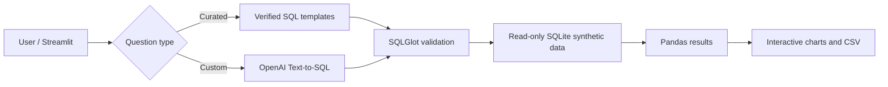

# InsightIQ — Conversational AI for Business Intelligence

A GitHub-ready, Streamlit-based AI-for-BI portfolio MVP. Explore **synthetic** healthcare operations data through curated questions or optional OpenAI-generated SQL. Queries are parsed with SQLGlot, restricted to a read-only allowlist of tables, and executed against SQLite. Inspect generated SQL, view interactive charts, and export CSV.

## Architecture



## Run locally

Python 3.11+ recommended.

```bash
python -m venv .venv
# Windows PowerShell: .venv\Scripts\Activate.ps1
# macOS/Linux: source .venv/bin/activate
pip install -r requirements.txt
pytest -q
streamlit run app.py
```

Choose a curated question and click **Analyze**. No API key is needed for curated examples. For custom questions, provide an OpenAI API key in the sidebar or set `OPENAI_API_KEY` as an environment variable. **API calls may incur costs.** The app uses OpenAI's chat-completions endpoint, with model `gpt-4o-mini` as a configurable default; access and model availability depend on your account.

## Deploy to Streamlit Community Cloud

1. Create a new GitHub repository, e.g. `insightiq-conversational-bi`.
2. Extract this ZIP and commit **all files** to the repository root (including `app.py`, `src/`, `requirements.txt`).
3. Go to https://share.streamlit.io and choose **Create app**, selecting your GitHub repository, branch `main`, and entry point `app.py`.
4. Deploy and open the public app. It works without an API key using curated examples.
5. For private custom-question demos, enter your own key into the sidebar. **Do not store keys in GitHub.** For a public app, consider disabling the custom LLM feature or adding authentication/rate limits before configuring a shared API key.

## Docker

```bash
docker build -t insightiq .
docker run --rm -p 8501:8501 insightiq
```

## Demo script

1. Open the app and explain the synthetic dataset (four facilities, daily data for 2025).
2. Run **Visits by facility** and inspect the generated SQL and chart.
3. Run **Monthly visits trend** and switch the chart to Line.
4. Export a CSV and explain the read-only SQL validation.
5. Optionally enter your own API key and ask a custom question.

## Security and limitations

- Synthetic data only. Never upload real PHI, confidential organizational data, or credentials.
- SQLGlot AST validation and a read-only SQLite connection reduce risk, but **are not a complete production SQL sandbox**. For production, add strict database permissions, query budgets, isolation, identity controls, audit logs, semantic metrics, evaluation, and rate limits.
- LLM SQL can be inaccurate; always inspect results. No guarantee of correctness.
- No conversation memory, RAG, agent orchestration, enterprise authentication, or production model monitoring in this MVP.
- The sample dataset is deterministically generated locally on first run and is excluded from Git.

## Resume description (after testing)

Built an independent conversational BI prototype using Streamlit, SQLite, SQLGlot, and optional LLM-powered Text-to-SQL, with read-only query validation, KPI visualization, and synthetic operational data.
